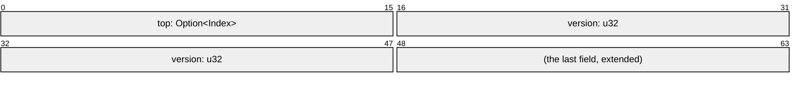

# A Free List

A free list hands out the free slots of an arena, one at a time, to threads that
each take a slot and give it back: the buffers of a pool, or the slots of
[a slot map](a-slot-map.md), which keeps its free ones on this list. This one is
a Treiber stack of indices whose head is one `u64`: the top index beside a
version. It holds no pointer, so it keeps strict provenance on every target, and
each change of the head is one compare-exchange.

## The Head

```rs
{{#include ../../crates/atomix/examples/free-list/free_list.rs:head}}
```

`Index` stops one short of `u16::MAX`, so `Option<Index>` spends that last repr
on `None` and stays 16 bits wide, as
[Values and Their Reprs](values-and-their-reprs.md) shows. The derive lays the
head out from bit 0, the top below the version:



Every node lives as long as the list, so a thread that read a node another has
since taken reads a stale successor, never freed memory. The version is what
makes that harmless. A thread that read the head, then waited while its top was
taken and given back, finds the version moved on, and its exchange fails:
without it, the exchange would land and put a stale successor on top, the ABA
problem. The version wraps after $2^{32}$ changes: a thread would have to sleep
through exactly that many for the problem to come back.

## Taking and Giving Back

```rs
{{#include ../../crates/atomix/examples/free-list/free_list.rs:pop}}
```

```rs
{{#include ../../crates/atomix/examples/free-list/free_list.rs:push}}
```

Each is a compare-exchange loop, and says so by name:
[`try_update`][`Atomic::try_update`] for the pop, whose closure declines an
empty list with `None`, and [`update`][`Atomic::update`] for the push. The pop
reads the head with `Acquire`, so the successor the top's push wrote, and
anything its last holder wrote to the slot, is seen. The push writes the node's
successor inside its closure, on each try, before the `Release` exchange that
publishes it. A node on the list is written by no one, and one off it by its
holder alone, so the successor needs no ordering of its own.

## Why an Index

A pointer to the node would take the head past one word: a version of 32 bits
beside a pointer needs [two words](two-words.md), which expose the pointer's
provenance, and the few bits a node's alignment leaves clear hold a version that
wraps within a handful of changes. An index keeps the head in one word, and the
slot is found from the arena's base, whose provenance it keeps.
[Choosing a Layout](choosing-a-layout.md) sets the three side by side.

## Using It

```rs
{{#include ../../crates/atomix/tests/book/cookbook/a_free_list.rs:use}}
```

The `free-list` example runs the list on four threads and prints the operations
a second, and `tests/model.rs` runs two threads taking and giving back nodes
under loom, as [Testing with Loom and Miri](testing-with-loom-and-miri.md)
shows:

```sh
cargo run --release -p atomix --features derive --example free-list
```

[`Atomic::try_update`]: api/atomix/struct.Atomic.html#method.try_update
[`Atomic::update`]: api/atomix/struct.Atomic.html#method.update
