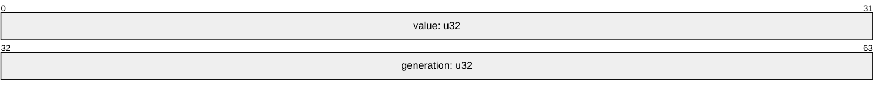

# A Slot Map

A slot map keeps values in the slots of an arena and hands back a key for each:
the slot, and the slot's generation as the value went in. A key may outlive its
value. Once the value is removed, the generation moves on, and the key finds
nothing, even after the slot holds another value. Each slot is one word, its
value beside its generation, so a lookup reads both at once, and a removal
checks the key and frees the slot in one compare-exchange.

## The Slot

```rs
{{#include ../../crates/atomix/tests/cookbook/slot_map.rs:slot}}
```



The generation is odd while the slot holds a value, and each insert and each
removal moves it on by one. Held apart, in two atomics, the value and the
generation could be read from two different moments: a lookup could find a later
value beside the generation it was looking for. In one word, they are one
moment.

## Inserting, Finding and Removing

```rs
{{#include ../../crates/atomix/tests/cookbook/slot_map.rs:insert}}
```

The free slots are on [the free list](a-free-list.md), so a slot an insert takes
is its own until the insert publishes it: it reads the generation and stores the
new value with no exchange.

```rs
{{#include ../../crates/atomix/tests/cookbook/slot_map.rs:get}}
```

A lookup is one load. A removal is a [`try_update`][`Atomic::try_update`] that
declines a slot whose generation is not the key's, so of two threads that remove
with one key, one finds the value, and the other finds the generation moved on.
The slot then goes back on the free list, whose push publishes it to the next
insert.

The generation wraps after $2^{32}$ changes, so a key that waited through
$2^{31}$ insertions and removals of its slot would find the value of the last. A
map that holds keys that long takes a wider generation, and a value of 16 bits
beside it.

## Using It

```rs
{{#include ../../crates/atomix/tests/book/cookbook/a_slot_map.rs:use}}
```

`tests/model.rs` runs a lookup with a key beside its removal and the slot's next
insert, under loom: the key finds its value or nothing, never the next one.

[`Atomic::try_update`]: api/atomix/struct.Atomic.html#method.try_update
