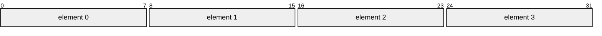
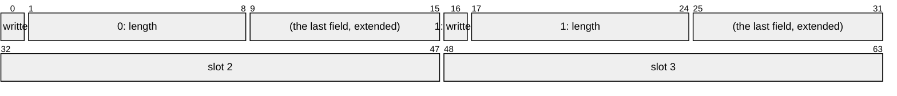

# Arrays and Element Places

An array `[T; N]` of values is a value: one atomic holds it whole, each element
in a slot as wide as its repr, element 0 lowest, and lends each element as a
place of its own, at an index known as the crate compiles or only at run time. A
book's four levels, 64 workers' busy bits or a ring's slots are each one word,
loaded, stored and exchanged whole, or changed an element at a time, in one
instruction.

## An Array in Slots

Each slot is as wide as its element's repr, so four bytes are a `u32`, their own
bytes, and a `bool` is one bit, so 64 of them are a `u64`:



```rs
{{#include ../../crates/atomix/tests/book/arrays_and_element_places.rs:slots}}
```

An array of bytes is its integer's, operation for operation: `[u8; 4]`'s load,
store, swap and `or` are `u32`'s instructions, as
[What Each Operation Costs](what-each-operation-costs.md#the-same-code-as-core)
pins. Where the slots fill the repr and every element decodes every pattern of
its bits, as four bytes do, the array is [`Total`], and where each element has
the bitwise operations, so does the array, each combining every element with its
own. Where they leave bits above, as three bytes in a `u32` do, those bits stay
clear and an `Option` takes a repr there. An atomic holds 128 bits at most, so a
longer array is refused, as one of no elements is; two pointers take two words,
as a pair of them does.

An array of `bool`s decodes eight from a byte by one multiply, and 64 from a
word by a vector, NEON's `tbl` or AVX2's `vpshufb`, and encodes them alike:
`[bool; 64]`'s load is 18 instructions on `x86_64`, no loop over its bits. A
loop that only tests bits reads them through their places, below, or through a
`u64`.

## Each Element, a Place

An atomic array lends each element as an [`AtomicField`], as a packed struct
lends each field, and each operation on one but `update` and `try_update`, its
loops, is one instruction on the whole word that changes that element alone:

```rs
{{#include ../../crates/atomix/tests/book/arrays_and_element_places.rs:elements}}
```

[`element`][`Atomic::element`] takes an index known at run time: it checks the
index, as indexing an array does, with std's message, and shifts the operand to
the element's slot, so a `bool`'s `test_and_set` is `cmp; jae; lock bts`, or
`cmp; b.hs; mov; lsl; ldsetal`, the refusal cold and, with LSE, frameless; at
Android's default CPU the fast path saves a frame record.
[`element_checked`][`Atomic::element_checked`] returns `None` past the end
rather than panicking, and [`element_unchecked`][`Atomic::element_unchecked`]
skips the check, leaving the shift alone. [`place`][`Atomic::place`] takes a
constant index, a field's place with no check and no shift at run time, the
position an immediate; it refuses one past the end as the crate builds:

```rs
{{#include ../../crates/atomix/tests/compile_fail/element_place_past_the_end.rs}}
```

```text
{{#include ../../crates/atomix/tests/compile_fail/element_place_past_the_end.stderr:1:1}}
```

[`elements`][`Atomic::elements`] lends every element's place at once. An element
has a field's operations but the add: a carry out of one slot would reach the
next element, so `fetch_add` is the last element's alone, through
[`last`][`Atomic::last`], where the slots fill the repr and its carry leaves the
word, as [Fields](fields.md) says of the field at the top:

```rs
{{#include ../../crates/atomix/tests/compile_fail/element_add.rs}}
```

```text
{{#include ../../crates/atomix/tests/compile_fail/element_add.stderr:1:11}}
```

## The Fields of an Element

An element that is a packed struct lends its fields as places too, at a run-time
index as at a constant one: `RING.element(index).fields().written` is the
`written` bit of the slot at `index`. A slot of a `bool` and a `u8` takes 16
bits, so four fill a `u64`:



```rs
{{#include ../../crates/atomix/tests/book/arrays_and_element_places.rs:element_fields}}
```

The field's operation runs after the index's check and a shift by the slot:
`cmpq; jae; shlq; lock btsq; setb` on `x86_64`, and `cmp; b.hs; lsl; mov; lsl;
ldsetal; tst; cset` on `aarch64`, which the codegen tests pin exactly on every
target. An element of an element is a place the same way: a grid's square is
both indices' checks, then their shifts joined and one `lock bts` or `ldsetal`,
with a frame saved for the two cold refusals:

```rs
{{#include ../../crates/atomix/tests/book/arrays_and_element_places.rs:grid}}
```

## An Index Held to the Range

An index the compiler knows to be in range needs no check. A [`RangedUsize`]
holds its index below the length, and LLVM knows its range, as
[Ranged Integers](ranged-integers.md) says, so the check folds away and an
element's test-and-set is the one instruction:

```rs
{{#include ../../crates/atomix/tests/book/arrays_and_element_places.rs:ranged_index}}
```

## A Packed Array

Slots spend a whole repr on each element, a byte on a two-variant enum. A
[`Packed<[T; N], R>`][`Packed`] packs the elements as a packed struct packs its
fields, each at the bits its range needs, in an integer `R` it states, so eight
sides fit a byte where their slots take eight, and sixteen `RangedU8<0, 3>` a
`u32`:

```rs
{{#include ../../crates/atomix/tests/book/arrays_and_element_places.rs:packed}}
```

`R` is stated, as a generic struct's repr is, and elements too wide for it fail
the build:

```rs
{{#include ../../crates/atomix/tests/compile_fail/packed_wider_than_its_integer.rs}}
```

```text
{{#include ../../crates/atomix/tests/compile_fail/packed_wider_than_its_integer.stderr:1:1}}
```

A `Packed` reads as its array, which it dereferences to, and an atomic of it
lends each element as a place, and a struct element's fields, at the element's
own width: a shift by the index times the width, and a mask of the element's
bits. It adds to none in place, since whether its elements fill `R` is a
constant, not a type.

[`AtomicField`]: api/atomix/struct.AtomicField.html
[`Atomic::element_checked`]: api/atomix/struct.Atomic.html#method.element_checked
[`Atomic::element_unchecked`]: api/atomix/struct.Atomic.html#method.element_unchecked
[`Atomic::element`]: api/atomix/struct.Atomic.html#method.element
[`Atomic::elements`]: api/atomix/struct.Atomic.html#method.elements
[`Atomic::last`]: api/atomix/struct.Atomic.html#method.last
[`Atomic::place`]: api/atomix/struct.Atomic.html#method.place
[`Packed`]: api/atomix/struct.Packed.html
[`RangedUsize`]: api/atomix/struct.RangedUsize.html
[`Total`]: api/atomix/validity/enum.Total.html
