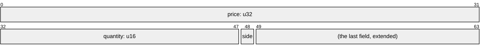
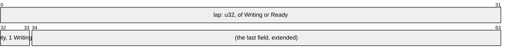
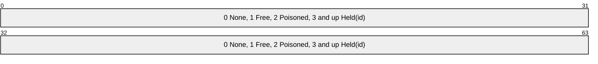

# Deriving Atom

[`#[derive(Atom)]`][`derive(Atom)`], with the `derive` feature, implements
[`Atom`] for a struct or an enum of values: it lays the type out in one atomic
word or two as the crate compiles, and refuses a type that does not fit, naming
what it needs. The impl it writes keeps each promise of `Atom`'s safety
contract, with no `unsafe` in your code, and is `const`, so a `static` of the
type builds.

## Shapes

The derive takes seven shapes, and its [Shapes][derive-shapes] section gives the
rules of each:

| Shape                                   | Its repr                                                                       |
| --------------------------------------- | ------------------------------------------------------------------------------ |
| a newtype, one field beside any markers | its field's, with the field's range and validity                               |
| a zero-width struct                     | a `u8` whose one value is 0                                                    |
| a fieldless enum                        | the integer its `#[repr]` names, or the narrowest that holds its variants      |
| a packed struct                         | the narrowest unsigned integer that holds its fields                           |
| an enum with fields                     | the same, its fields below a tag, or a niche in place of one                   |
| a pointer word, a pointer enum          | its pointer's, the other fields as tags: [Tagged Pointers](tagged-pointers.md) |

A pointer word's pointer may be a shared reference or a function pointer, as
[References and Function Pointers](references-and-function-pointers.md) shows; a
pointer enum's is a raw pointer or a `NonNull`, never a reference or a function
pointer, which no bits forge. A tuple needs no derive: it is laid out as the
struct of its fields, where each field fills its repr
([Tuples and Core's Values](tuples-and-core-values.md)).

A packed struct or an enum with fields takes up to 128 bits, in a `u128` past
64, which needs the target's 16-byte atomic, as [Two Words](two-words.md) says;
and no field is an atomic, a cell or a lock, as
[Values and Places](values-and-places.md) says.

## A Packed Struct

Each field takes bits of its own, from bit 0 in declaration order, as few as its
[`REPRS`][`Atom::REPRS`] need: a `bool` or a two-variant enum takes one, a `u16`
sixteen. A quote of 32, 16 and 1 bits takes 49 of a `u64`:



```rs
{{#include ../../crates/atomix/tests/book/deriving_atom.rs:packed}}
```

A field whose range holds negative numbers takes two's complement where that is
narrower, and the bits above the struct's last field extend that field, so a
signed last field's sign fills them:

```rs
{{#include ../../crates/atomix/tests/book/deriving_atom.rs:signed}}
```

The width is checked where the type is defined, and a struct past 128 bits is
refused there:

```rs
{{#include ../../crates/atomix/tests/compile_fail/derive_on_a_struct_too_wide.rs}}
```

```text
{{#include ../../crates/atomix/tests/compile_fail/derive_on_a_struct_too_wide.stderr:1:1}}
```

## An Enum with Fields

An enum whose variants hold fields keeps a tag of each variant's discriminant
above the widest variant's fields, packed as a struct's are:



```rs
{{#include ../../crates/atomix/tests/book/deriving_atom.rs:enum_with_fields}}
```

Where one variant alone holds fields and none states a discriminant, the enum
fills that variant's niche instead, unless the niche is wider than a tag: the
unit variants take reprs beside the variant's range, as `Option`'s `None` does.
A lock whose owner's id starts at 3 keeps its two other states, and `None`, in
the id's own `u64`:



```rs
{{#include ../../crates/atomix/tests/book/deriving_atom.rs:niche}}
```

[A Lock Word](a-lock-word.md) takes and frees this word, and
[Ranged Integers](ranged-integers.md#the-integers-below-the-range) says why the
id starts at 3.

## Repr

The table above gives each shape's repr. `#[atom(repr = u64)]` states it, and
the build then refuses a type that outgrows it; a generic packed struct or enum
with fields states one, as below. No repr is wider than 128 bits, or 64 on
`x86_64` without `cmpxchg16b`. The derive's [Repr][derive-repr] section gives
each rule.

## Validity

The derive computes the type's [validity](values-and-their-reprs.md#validity)
from its fields, as its [Validity][derive-validity] section says: a struct whose
fields decode every pattern of their bits and fill the repr is `Total`, so a
struct of two `u32`s in a `u64` is, while the quote above, whose fields leave 15
bits over, is `ZeroValid`, since each field's zero decodes. The lock is
`Partial`, as its id's validity promises nothing of zero.

## Generic Types

A generic type is laid out for each instance, and checked against the repr it
states as each instance is built. An instance whose field leaves reprs spare
fills its niche, and one whose field leaves none takes a tag:

```rs
{{#include ../../crates/atomix/tests/book/deriving_atom.rs:generic}}
```

Where the impl converts a field that names one of the type's parameters, the
type's crate enables `#![feature(const_trait_impl)]`, as this book's tests do; a
type whose parameters reach its markers alone needs no gate. The derive's
[Generic Types][derive-generic-types] section says which needs which.

## Threads

An `Atomic` crosses threads, so the derive checks that the type is `Send` and
`Sync` beside the impl, and bounds the impl so where the type has parameters. A
field written as a raw pointer, a `NonNull` or an `Option` of one is exempt, as
a pointer's `Atom` impl promises; the derive's [Threads][derive-threads] section
gives the rule.

## Capabilities

[`#[derive(AtomAdd)]`][`derive(AtomAdd)`],
[`#[derive(AtomOrd)]`][`derive(AtomOrd)`] and
[`#[derive(AtomBitwise)]`][`derive(AtomBitwise)`] give a newtype the
read-modify-writes its field has, as
[What Each Operation Costs](what-each-operation-costs.md) shows. A packed struct
has none of them, and the derive refuses one there: an add or an or across its
fields would mean nothing, so [its fields](fields.md) each take their own.

[`Atom::REPRS`]: api/atomix/trait.Atom.html#associatedconstant.REPRS
[`Atom`]: api/atomix/trait.Atom.html
[`derive(Atom)`]: api/atomix/derive.Atom.html
[`derive(AtomAdd)`]: api/atomix/derive.AtomAdd.html
[`derive(AtomBitwise)`]: api/atomix/derive.AtomBitwise.html
[`derive(AtomOrd)`]: api/atomix/derive.AtomOrd.html
[derive-generic-types]: api/atomix/derive.Atom.html#generic-types
[derive-repr]: api/atomix/derive.Atom.html#repr
[derive-shapes]: api/atomix/derive.Atom.html#shapes
[derive-threads]: api/atomix/derive.Atom.html#threads
[derive-validity]: api/atomix/derive.Atom.html#validity
