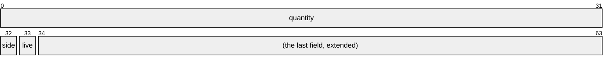

# Fields

An atomic packed struct lends each of its fields as a place of its own, an
[`AtomicField`]: `quote.fields().live` is the bit `live` of the quote's word,
which one instruction on the whole word changes alone. [`Atomic::fields`] lends
the places through the projection the derive writes beside the struct,
`QuoteFields`, one place a field.

A struct in one word is read and exchanged whole, and that is often what a
program needs. Changing one field with the word's own operations would take a
mask written by hand, which nothing checks against the layout, or a
compare-exchange loop over the whole value. A field's place changes it in the
word's one instruction, its operand confined to the field, and the operation
exists only where it means something for the field.

## A Book of Quotes

The `quote-book` example keeps one quote at each price level: 32 bits of
quantity, a bit of side, and a bit that says whether a taker may take it.

```rs
{{#include ../../crates/atomix/examples/quote-book/quote_book.rs:quote}}
```



The feed posts a quote only to a level whose last quote is taken and freed,
which it checks and writes in one loop, by name:

```rs
{{#include ../../crates/atomix/examples/quote-book/quote_book.rs:post}}
```

A taker takes a quote by clearing its `live` bit, which one taker alone finds
set, and frees the level by clearing its quantity, each one instruction on the
quote's word:

```rs
{{#include ../../crates/atomix/examples/quote-book/quote_book.rs:take}}
```

Four takers race for one quote, and one takes it whole:

```rs
{{#include ../../crates/atomix/tests/book/fields.rs:book}}
```

`cargo run --release -p atomix --features derive --example quote-book` runs a
feed and three takers through a million posts.

## What Each Field Takes

| Field                                       | Operations                                                                             | The container's repr needs        |
| ------------------------------------------- | -------------------------------------------------------------------------------------- | --------------------------------- |
| every field                                 | `load` or `load_rmw`, `update`, `try_update`                                           | [`Load`], for `load`              |
| a `bool`                                    | `set`, `clear`, `toggle`, `store`; `test_and_set`, `test_and_clear`, `test_and_toggle` | [`MaskBitwise`]; [`BitTest`]      |
| a value with [`FieldBitwise`]               | `and`, `or`, `xor`, `not`; their `fetch_` forms                                        | [`MaskBitwise`]; [`FetchBitwise`] |
| the field at the top bit, with [`FieldAdd`] | `fetch_add`, `fetch_sub`                                                               | [`FetchAdd`]                      |

[`AtomicField`]'s page holds each operation's rule;
[What Each Operation Costs](what-each-operation-costs.md) says which target has
which capability.

A field has no plain store. A store of some bits of a word alone would race the
other fields' read-modify-writes, so a `bool`'s `store` is its `set` or `clear`,
and any other field's is an `update`, a loop by name. The field at the word's
top bit adds in place, since its carry leaves the word; an add to a field below
it would carry into the field above, so it is refused:

```rs
{{#include ../../crates/atomix/tests/compile_fail/field_add_below_the_top.rs}}
```

```text
{{#include ../../crates/atomix/tests/compile_fail/field_add_below_the_top.stderr:1:11}}
```

Here an order's count of what filled sits at the top, its flags, a struct of
their own, below its price:

```rs
{{#include ../../crates/atomix/tests/book/fields.rs:order}}
```

A `fetch_` form returns the container before, the one snapshot of every field
that its instruction read. The bitwise ones exist where the target has
[`FetchBitwise`], on `aarch64`; on `x86_64`, a `bool` field's `test_and_set` and
its kin return the bit:

```rs
{{#include ../../crates/atomix/tests/book/fields.rs:fetch_forms}}
```

## Fields of Fields

A field whose value is a packed struct lends that struct's fields in turn, as
`flags.fields()` does above, and an operation on a field of a field is still one
instruction on the whole word. Each place takes its field's visibility, so a
private field's place stays in its module, where any invariant the field carries
is kept; the derive's [Projections][derive-projections] section holds the rules.
Code generic over a place takes an `&AtomicField<P>` and states what it asks of
the container's repr, as the derive's example
[Changing a Field Through Generic Code][derive-changing-a-field-through-generic-code]
does. An array's element is a place of the same kind, its fields too, at an
index known as the crate compiles or only at run time, as
[Arrays and Element Places](arrays-and-element-places.md) shows.

## What It Costs

A field's operation is the mask written by hand over core's atomics, instruction
for instruction: `tests/codegen.rs` holds a field's `set`, `clear`, `toggle`,
`store`, `test_and_set`, `load`, `or`, `and`, `xor`, `not` and `fetch_add` to
their twins written so, on every target. The two part only at a test of a bit on
`x86_64`, where LLVM writes the mask by hand as a compare-exchange loop at some
bits and as other instructions at others, and a field's test is one `lock bts`,
`btr` or `btc` at every bit, as
[What Each Operation Costs](what-each-operation-costs.md#a-bit-chosen-at-run-time)
says. [Performance](performance.md#against-core-and-its-peers) times a field's
operations against the mask by hand, and against the compare-exchange loop on
the whole value that a crate holding any `T` would need to change one field.

[`Atomic::fields`]: api/atomix/struct.Atomic.html#method.fields
[`AtomicField`]: api/atomix/struct.AtomicField.html
[`BitTest`]: api/atomix/trait.BitTest.html
[`FetchAdd`]: api/atomix/trait.FetchAdd.html
[`FetchBitwise`]: api/atomix/trait.FetchBitwise.html
[`FieldAdd`]: api/atomix/trait.FieldAdd.html
[`FieldBitwise`]: api/atomix/trait.FieldBitwise.html
[`Load`]: api/atomix/trait.Load.html
[`MaskBitwise`]: api/atomix/trait.MaskBitwise.html
[derive-changing-a-field-through-generic-code]: api/atomix/derive.Atom.html#changing-a-field-through-generic-code
[derive-projections]: api/atomix/derive.Atom.html#projections
