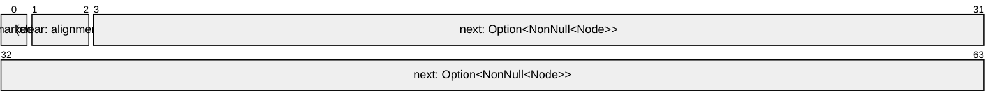

# Marking Links for Removal

A sorted linked list that threads change without a lock has one race no single
compare-exchange settles: a thread unlinks a node by pointing its predecessor
past it, while another links a new node after it, and the new node goes out with
the old one. Tim Harris's answer,
[A Pragmatic Implementation of Non-Blocking Linked-Lists][harris-lists], marks
the node's own link first. A node whose link is marked is on its way out, and
every exchange that would change that link expects it unmarked, so it fails: no
thread links a node after one that is going.

## The Link

```rs
{{#include ../../crates/atomix/tests/cookbook/sorted_list.rs:link}}
```

The link is a [pointer word](tagged-pointers.md): the next node's pointer, and
the mark in bit 0, which a node's alignment of 8 leaves clear. In one word, a
node's link and its mark change together, and the pointer keeps its provenance
strictly.



## Inserting and Removing

```rs
{{#include ../../crates/atomix/tests/cookbook/sorted_list.rs:insert}}
```

An insert finds the link that leads past every smaller key, points the new node
at what it leads to, and exchanges the link for one to the new node, expecting
it unmarked: if its node is on its way out, the exchange fails, and the search
starts again.

```rs
{{#include ../../crates/atomix/tests/cookbook/sorted_list.rs:remove}}
```

A removal marks the node's link with its tag's
[`test_and_set`][`AtomicField::test_and_set`], one `lock bts` or `ldset` on the
pointer: the one thread that finds the mark clear removes the node, and any
other learns it is going. Unlinking it is then any sweep's: each insert's and
removal's `sweep_to` points a marked node's predecessor past it as it passes, so
the node is gone once some sweep has passed it, Maged Michael's form of Harris's
list. `contains` writes nothing: it walks past a marked node, and finds its key
out.

## Nodes and Their Memory

The list frees nothing. Its nodes come from an arena that outlives it, so a
thread that reads a node another has unlinked reads a whole node, and the one
`unsafe` block, which reads a node through a pointer the list holds, needs only
that, and that each node goes in once, into one list: a node claims a flag as it
goes in, and the list's lifetime cannot outgrow its arena's. A list that frees
its nodes needs to know when no thread can still read one, which atomix leaves
out: crossbeam-epoch, or another reclaimer, does that beside atomix's atomics.

## Using It

```rs
{{#include ../../crates/atomix/tests/book/cookbook/marking_links_for_removal.rs:use}}
```

`tests/model.rs` runs the insertion of 25 beside the removal of 20, the node it
goes after, under loom: 25 is in the list at the end, under every interleaving
loom explores. An insert that links after a node whatever its mark loses 25, and
the model keeps that insert as a twin that must fail. The listings run under
Miri with strict provenance too.

[`AtomicField::test_and_set`]: api/atomix/struct.AtomicField.html#method.test_and_set
[harris-lists]: https://doi.org/10.1007/3-540-45414-4_21
