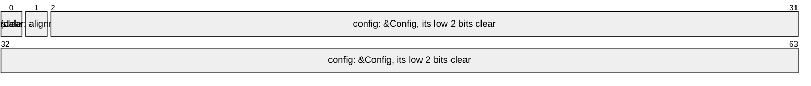

# References and Function Pointers

A shared reference `&'a T` and a function pointer are values, with no wrapper:
`Atomic<&'a Config>` shares a config that threads read and one replaces whole,
and `Atomic<Option<fn(&str) -> usize>>` a hook a thread installs. Each is stored
as its pointer, inside a repr only a reference or a function pointer of that
very type gives, [`ReprOf`], so no bits read from memory or built from an
integer decode as one. Null is neither's, so an `Option` of either costs
nothing, and each operation is a raw pointer's instruction, as
[What Each Operation Costs](what-each-operation-costs.md#the-same-code-as-core)
pins.

## A Reference

A reference read must see the writes that made what it points to, and one
written must publish them: a `Relaxed` store of a fresh `&Config` beside a
`Relaxed` load that reads through it would race on the config's bytes, which is
undefined behaviour in safe code. So a reference's orderings have a floor: a
load takes `Acquire` or `SeqCst`, a store `Release` or `SeqCst`, and a
read-modify-write `AcqRel` or `SeqCst`. An `Option` of one, a newtype over one,
an array or a tuple of them, and a struct that holds one take the same floor,
from the repr:

```rs
{{#include ../../crates/atomix/tests/book/references_and_function_pointers.rs:reference}}
```

A `Relaxed` load does not compile, and the error says why:

```rs
{{#include ../../crates/atomix/tests/compile_fail/reference_load_with_relaxed.rs}}
```

```text
{{#include ../../crates/atomix/tests/compile_fail/reference_load_with_relaxed.stderr:1:10}}
```

An atomic of `&'a T` lives no longer than `'a`, and stores nothing shorter, so a
`static` holds a `&'static` reference alone:

```rs
{{#include ../../crates/atomix/tests/compile_fail/reference_to_a_local_in_a_static.rs}}
```

```text
{{#include ../../crates/atomix/tests/compile_fail/reference_to_a_local_in_a_static.stderr:1:12}}
```

A reference to a slice, a `str` or a trait object is two words, a
[`DoubleWord`][two-words], as such a raw pointer is.

## Generic Code

Code generic over the value an atomic holds orders it `Relaxed` only where the
value holds no reference, which [`HoldsNoReference`] says; rustc suggests the
bound to a function that lacks it. An `Acquire` read-modify-write asks
[`PublishesNoReference`] alike:

```rs
{{#include ../../crates/atomix/tests/book/references_and_function_pointers.rs:generic}}
```

A reference is a value of its own, so a method of [`Atom`] called on one encodes
the reference rather than reading through it: `to_repr` on a `&u64` gives the
reference's repr, and `Atomic::new(&x)`, rustc's suggestion where a value is not
`Atom`, makes an atomic of the reference. Call each on the value:

```rs
{{#include ../../crates/atomix/tests/book/references_and_function_pointers.rs:encoded}}
```

## A Function Pointer

A function pointer points to code, which no write changes, so its operations
take every ordering, `Relaxed` among them, and a load is one `ldr` or `mov`.
Where the atomic's type is known, a function's name and a closure that captures
nothing coerce to the pointer:

```rs
{{#include ../../crates/atomix/tests/book/references_and_function_pointers.rs:function}}
```

A function's name alone is a function item, a type of its own with no bits, not
a pointer, so an atomic whose type is not named would hold the item, which is no
atomic value:

```rs
{{#include ../../crates/atomix/tests/compile_fail/function_item_stored_as_itself.rs}}
```

```text
{{#include ../../crates/atomix/tests/compile_fail/function_item_stored_as_itself.stderr:24:33}}
```

A compare-exchange compares addresses, and one function may have several, or two
functions one, so it takes `current` from a load or a failed exchange, never
from a function named afresh.

## Tags Beside a Reference

A word keeps tags beside a reference in the low bits `T`'s alignment leaves
clear, as it keeps them beside a `NonNull`
([Tagged Pointers](tagged-pointers.md)), and a tuple of a reference and small
values is the same word:



The reference's floor holds for the word whole and for the reference's place. A
tag's own load, `set`, `clear`, `toggle` and `test_and_set` hand out the tag
alone, nothing of what the reference points to, so they take every ordering, at
no cost: a `Relaxed` load is `ldr` or `movq`, and a `Relaxed` set `ldset` or
`lock or`, as beside a `NonNull`:

```rs
{{#include ../../crates/atomix/tests/book/references_and_function_pointers.rs:tags}}
```

A tag's `update`, `try_update` and `fetch_` forms return the word, the reference
among it, so their read takes `Acquire`, through [`FieldOf`]; their write puts
the reference back as it read it, so needs no `Release`: an `Acquire` update is
a `casa` loop, and an `Acquire` `fetch_or` one `ldseta`, not `casal` or
`ldsetal`:

```rs
{{#include ../../crates/atomix/tests/compile_fail/tag_update_beside_a_reference_with_relaxed.rs}}
```

```text
{{#include ../../crates/atomix/tests/compile_fail/tag_update_beside_a_reference_with_relaxed.stderr:1:8}}
```

A function pointer's code leaves no bit clear, so its tags take a word of their
own, `#[atom(repr = u128)]`, as [Two Words](two-words.md) shows for a pointer
beside more tags than its alignment holds:

```rs
{{#include ../../crates/atomix/tests/book/references_and_function_pointers.rs:function_tags}}
```

## A Function Pointer's Place

A function pointer's atomic lends its place, as a raw pointer's does, so
[`from_ptr`][`Atomic::from_ptr`] views a slot another language keeps, such as a
C library's callback, as an atomic of it, and [`as_ptr`][`Atomic::as_ptr`] gives
that slot back:

```rs
{{#include ../../crates/atomix/tests/book/references_and_function_pointers.rs:places}}
```

[`Atom`]: api/atomix/trait.Atom.html
[`Atomic::as_ptr`]: api/atomix/struct.Atomic.html#method.as_ptr
[`Atomic::from_ptr`]: api/atomix/struct.Atomic.html#method.from_ptr
[`FieldOf`]: api/atomix/ordering/struct.FieldOf.html
[`HoldsNoReference`]: api/atomix/ordering/trait.HoldsNoReference.html
[`PublishesNoReference`]: api/atomix/ordering/trait.PublishesNoReference.html
[`ReprOf`]: api/atomix/struct.ReprOf.html
[two-words]: two-words.md
