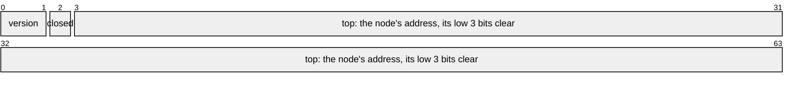

# Tagged Pointers

A pointer to a value aligned to 8 has three low bits that are always clear. A
pointer word is a struct of a pointer beside small fields, which
[`#[derive(Atom)]`][`derive(Atom)`] keeps as tags in those bits: the whole word
is the pointer's one atomic, so a field changes in the same instruction that
reads or exchanges the pointer.

Lock-free structures use tags for what must change with the pointer: a version
beside a stack's top, so a top popped and pushed again is not mistaken for the
one read; a mark on a list's link, so no thread links a node after one on its
way out; a bit that closes a stack. A tag kept in a separate atomic would change
apart from the pointer it describes, and a second word would double the atomic's
width.

## A Pointer Word

The head of a Treiber stack keeps its top node, a version of two bits, and a bit
that closes the stack, in one pointer:

```rs
{{#include ../../crates/atomix/tests/book/tagged_pointers.rs:head}}
```

The derive lays the tags out from bit 0, the pointer's own above them:



`load` takes the tags off with a mask, `ldar` and `and`, and `head.fields()`
lends each field as a place of its own, as a packed struct does in
[Fields](fields.md): the top pointer's place reads the pointer through the word,
and a tag's place has a `bool`'s or an integer's operations on the pointer
itself. Closing the stack is one `lock bts`, or `ldsetal`, on the top pointer,
with no loop, and the one thread that finds the bit clear closes it.

## Provenance, Kept

A pointer read back from a word may be used as the pointer stored, since atomix
keeps its provenance: a tag is set with the pointer's own `map_addr` or
`wrapping_byte_add`, or with `AtomicPtr`'s `fetch_or`, `fetch_and` and
`fetch_xor`, never by casting an integer to a pointer, and no provenance is
exposed. So a word passes Miri under `-Zmiri-strict-provenance`, and the
listings on this page run under it, as
[Testing with Loom and Miri](testing-with-loom-and-miri.md#miri) shows. Two
words cannot keep a provenance, as [Two Words](two-words.md) says.

## What the Build Checks

The tags need the bits the pointee's alignment leaves clear, and the build
checks they fit, for each pointer word and, for a generic one, in each instance.
A byte of tags beside a pointer to a `u64`, aligned to 8, does not:

```rs
{{#include ../../crates/atomix/tests/compile_fail/derive_on_a_pointer_word_with_tags_past_its_pointees_alignment.rs}}
```

```text
{{#include ../../crates/atomix/tests/compile_fail/derive_on_a_pointer_word_with_tags_past_its_pointees_alignment.stderr:1:10}}
```

`#[repr(align(8))]` on a pointee makes room where its fields' alignment leaves
too little, and `#[atom(repr = u128)]` gives tags no alignment holds a word of
their own. The layout never reads the pointee's alignment, only the check does,
so a node may hold an atomic of the word that points to it, as the stack's does.

## What a Word Costs

A store, a swap or a compare-exchange encodes the word, and a pointer with a bit
set where its tags go would lose that bit: each tests its pointer once, against
every tag bit, and branches to one cold refusal, a panic, off its fast path; a
compare-exchange tests both its pointers in one test.
[Performance](performance.md#against-core-and-its-peers) times the test against
the same code with the tags masked by hand. A loop of `update` tests nothing its
decode already cleared, and a load and a tag's operations test nothing. The
facade's [What Each Operation Costs][facade-costs] section says where else a
word saves a frame record or keeps a branch.

## Null, Constants and `Option`

A constant reads no pointer's address but null's, so a `static` starts with a
null pointer, its tags set or not, and takes a node's pointer at run time. A
word whose pointer is never null, a `NonNull`, gives `Option`'s `None` the null
repr, so its `Option` takes no bit; one whose pointer may be null, as the
stack's head, leaves `None` nothing, and its `Option` is refused.

## Pointer Enums and Words Inside Words

A pointer enum is an enum some of whose variants hold a pointer: each variant's
tag is its discriminant, in the bits every pointer's alignment leaves clear, and
a variant's other data lies above those bits. A word may hold a word, or a
pointer enum, as its pointer, marked `#[atom(pointer)]`, since the derive sees a
pointer only where its type is written as one; the outer word's tags go above
the inner one's:

```rs
{{#include ../../crates/atomix/tests/book/tagged_pointers.rs:pointer_enum}}
```


A match of a pointer enum folds the arm's tag into the offset of the load
through its pointer. The derive's [Shapes][derive-shapes] section holds the
rules of each, and its examples [Tagging a Pointer][derive-tagging-a-pointer]
and [Storing a Pointer Enum][derive-storing-a-pointer-enum] tag a pointer, nest
a word in a word, and store a pointer enum. The cookbook's
[Marking Links for Removal](marking-links-for-removal.md) builds a list whose
links carry their mark this way.

[`derive(Atom)`]: api/atomix/derive.Atom.html
[derive-shapes]: api/atomix/derive.Atom.html#shapes
[derive-storing-a-pointer-enum]: api/atomix/derive.Atom.html#storing-a-pointer-enum
[derive-tagging-a-pointer]: api/atomix/derive.Atom.html#tagging-a-pointer
[facade-costs]: api/atomix/index.html#what-each-operation-costs
