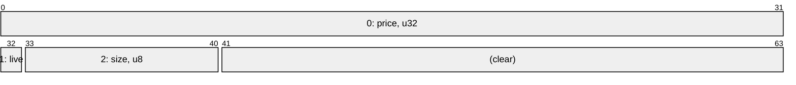
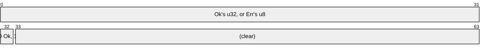

# Tuples and Core's Values

A tuple of one to twelve values is a value, its fields side by side, and so are
the small values of core and std that fit one atomic, from an IP address to a
`Result`: each needs no derive and no wrapper, and each is laid out so its
operations are its repr's own instructions.

## Tuples

A tuple's fields sit side by side from bit 0, each in a slot as wide as its
repr, as an array's elements do, in the narrowest integer that holds them, and
the bits above the slots are clear. Where each field fills its repr, as an
integer or a `bool` does, that is the layout a derived struct of the same fields
takes; a field narrower than its repr, a two-variant enum or a ranged integer,
takes its whole slot, where a derived struct packs it at its range's width and
extends a signed top field's sign above it:

```rs
{{#include ../../crates/atomix/tests/book/tuples_and_core_values.rs:slots}}
```

A tuple's atomic lends a tuple of places, through `fields().0` and its kin:



```rs
{{#include ../../crates/atomix/tests/book/tuples_and_core_values.rs:tuples}}
```

Each field's operation is a derived struct field's: `(u32, bool)`'s flag is
`lock bts` at bit 32, and `(u32, u32)`'s second field's load a shift. A tuple
has the bitwise operations where each field has them and the fields fill the
repr; its last field adds in place where its slot reaches the repr's top and
every repr of the slot decodes, as [Fields](fields.md) says of a struct's.

## Beside a Pointer

A tuple of a pointer and small values keeps them in the pointer's low bits, as a
pointer word keeps its tags, so `(NonNull<Node>, bool)` is the word
[Tagged Pointers](tagged-pointers.md) derives, with the same code:

```rs
{{#include ../../crates/atomix/tests/book/tuples_and_core_values.rs:beside_a_pointer}}
```

Up to 29 bits of fields, the most Rust's largest alignment leaves clear, go in
the pointer's low bits, and a pointee whose alignment leaves fewer fails the
build, naming the fix; more take an integer word beside the pointer, two words
in all. So does any field beside a function pointer, whose code leaves no bit
clear, and a second pointer takes the second word, the others in the first's low
bits:

```rs
{{#include ../../crates/atomix/tests/book/tuples_and_core_values.rs:beside_a_function}}
```

A third pointer has no word to go in, and is refused:

```rs
{{#include ../../crates/atomix/tests/compile_fail/tuple_of_three_pointers.rs}}
```

```text
{{#include ../../crates/atomix/tests/compile_fail/tuple_of_three_pointers.stderr:1:9}}
```

A tuple that holds a reference keeps the reference's floor, while a flag beside
it takes every ordering where it hands out itself alone, as
[References and Function Pointers](references-and-function-pointers.md#tags-beside-a-reference)
shows. A derived struct names its fields, packs each at its range's width, and
states its own layout where it needs to; a tuple suits a value whose parts need
no names, or one that crosses an API as a tuple already.

## Core's Values

Core's small values are atomic values where they fit one atomic, each its fields
side by side in one integer, laid out so its load is that integer's:

| Value                                                           | Its repr                                                                |
| --------------------------------------------------------------- | ----------------------------------------------------------------------- |
| `Ipv4Addr`, `Ipv6Addr`                                          | a `u32` or a `u128` of its octets in core's order: a load swaps no byte |
| `SocketAddrV4`                                                  | a `u64`: the address's octets, then the port from bit 32                |
| `Duration`                                                      | a `u128`: its seconds in the upper word, its nanoseconds in the lower   |
| `cmp::Ordering`                                                 | its `i8`                                                                |
| `NonZero<char>`                                                 | its scalar value                                                        |
| `Reverse<T>`, `Wrapping<T>`, `Saturating<T>`, `ManuallyDrop<T>` | `T`'s                                                                   |
| `Result`, `ControlFlow` and `Bound` of values stored as bits    | the wider payload's slot from bit 0, the variant's index above it       |
| `Poll<T>`                                                       | `Option<T>`'s, `Pending` its `None`                                     |
| core's ranges that are `Copy`                                   | the array of their bounds, or their one bound                           |
| `Layout`                                                        | its size and its alignment, a word each                                 |
| `mem::Alignment`, `ascii::Char`                                 | its logarithm, and its code                                             |
| `FpCategory`, `fmt::Alignment`                                  | its variant's index                                                     |
| `PhantomPinned`, `RangeFull`, `fmt::Error`, `Infallible`        | no bits                                                                 |

Each keeps what its value means: an `Ipv4Addr` is [`Total`], and its `and`,
`or`, `xor` and `not` apply octet by octet, as its own `&` and `|` do, so a
netmask is one `lock and` or `ldclral`; it has no maximum, since a repr that
ordered as the address would swap the bytes of every load. A `Duration`'s and an
`Ordering`'s reprs order as they do, so each has [`AtomOrd`], and an
`Ordering`'s `fetch_max` is one `ldsmaxalb` on `aarch64`:

```rs
{{#include ../../crates/atomix/tests/book/tuples_and_core_values.rs:core_values}}
```

A `Result<u32, u8>` is a `u64`, its tag `Ok`'s 0, so zero is `Ok(0)`, and a
loaded result's `is_ok` is one compare of the tag:



A `Duration`, a `Layout` and an `Ipv6Addr` take 128 bits, so they are atomic
where 128 bits are, as [Two Words](two-words.md) says; a `Duration`'s load moves
its words as they are, with no shift:

```rs
{{#include ../../crates/atomix/tests/book/tuples_and_core_values.rs:durations}}
```

Left out are `IntErrorKind` and `atomic::Ordering`, whose `#[non_exhaustive]`
leaves a variant core adds with no repr, and `AllocError`.

## Values from `std`

The `std` feature adds three of std's values, on Unix and Windows:

- `SystemTime`, where 128 bits are atomic: an `i128` of its whole seconds since
  the Unix epoch, rounded down and signed, above its nanoseconds, so it orders
  as the time and zero is the epoch;
- `ExitStatus`: its raw wait status on Unix but Fuchsia, and its code on
  Windows;
- `BorrowedFd`, on Unix: sealed in a [`ReprOf`], as a reference is, a `u32` of
  the descriptor's complement, so -1, no descriptor, is zero and an `Option` of
  one is free, and no bits make one a `BorrowedFd` did not lend.

None is `const`, as std's conversions are not, so an atomic of one is made with
`Atomic::from`:

```rs
{{#include ../../crates/atomix/tests/book/tuples_and_core_values.rs:std_values}}
```

[`AtomOrd`]: api/atomix/trait.AtomOrd.html
[`ReprOf`]: api/atomix/struct.ReprOf.html
[`Total`]: api/atomix/validity/enum.Total.html
