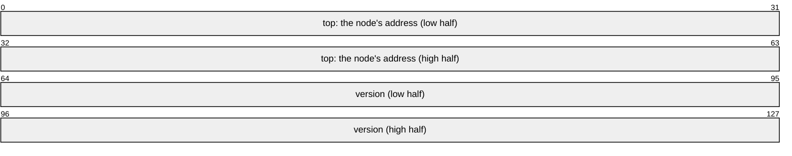

# Two Words

A [`DoubleWord`] is two words in one 16-byte atomic, each a pointer or an
integer: two pointers, a pointer beside a counter or beside tags no alignment
holds, or a pointer to a slice, a `str` or a trait object, its length or its
vtable beside it. An atomic of such a value changes both words in one
instruction.

A Treiber stack's version shows why. Two bits of version beside the top pointer
in one word, as in [Tagged Pointers](tagged-pointers.md), wrap after four
changes, so a thread that sleeps through four changes that put the same top back
can mistake the head for the one it read. A `u64` version wraps after $2^{64}$,
and no alignment leaves 64 bits clear, so it takes a word of its own.

## Two Words in One Exchange

```rs
{{#include ../../crates/atomix/tests/book/two_words.rs:pop}}
```



`#[derive(Atom)]` lays a struct out in two words where one cannot hold it: two
pointers, one pointer beside more than 29 bits of tags, which no alignment
holds, or a wide pointer beside no tag. A pointer word of one pointer may state
`#[atom(repr = u128)]` to put its tags in a word of their own even where they
would fit the pointer's low bits. The derive's [Repr][derive-repr] section says
each rule, and its example
[Tagging Pointers in Two Words][derive-tagging-pointers-in-two-words] shows a
struct of two pointers beside one that states `repr = u128`. A field of a
two-word value is a place, as a field of one word is, with its loads and its
loops alone: no target has a 16-byte bitwise instruction.

A slice's pointer keeps its length beside it the same way:

```rs
{{#include ../../crates/atomix/tests/book/two_words.rs:slice}}
```

## What Each Target Runs

Two words take `u128`'s instructions, here for an `Acquire` read, a `Release`
write and an `AcqRel` exchange:

| Operation          | `aarch64`, `+lse` | `aarch64`, LSE2    | `x86_64`, `cmpxchg16b` | `x86_64`, AVX          |
| ------------------ | ----------------- | ------------------ | ---------------------- | ---------------------- |
| `compare_exchange` | `caspal`          | `caspal`           | `lock cmpxchg16b`      | `lock cmpxchg16b`      |
| `load`             | none              | `ldp`, `dmb ishld` | none                   | `vmovdqa`              |
| `store`            | none              | `dmb ish`, `stp`   | none                   | `vmovdqa`              |
| `load_rmw`         | `caspa`           | `caspa`            | `lock cmpxchg16b`      | `lock cmpxchg16b`      |
| `store_rmw`        | a loop of `casp`  | a loop of `casp`   | a loop of `cmpxchg16b` | a loop of `cmpxchg16b` |

Where a target has no 16-byte load, `load` does not exist, and
[`load_rmw`][`Atomic::load_rmw`] reads with a compare-exchange of zero for zero,
which writes the cache line, by name:

```rs
{{#include ../../crates/atomix/tests/compile_fail/aarch64_without_lse2/load_on_a_two_word_value.rs}}
```

```text
{{#include ../../crates/atomix/tests/compile_fail/aarch64_without_lse2/load_on_a_two_word_value.stderr:1:9}}
```

Two words have no `swap`, since no target swaps 16 bytes in one instruction, as
[No Loop on 16 Bytes](what-each-operation-costs.md#no-loop-on-16-bytes) shows;
an `update` that ignores the value it reads is the loop a swap would be.
`x86_64` without `cmpxchg16b`, Linux's default CPU, has no 16-byte atomic at
all, and refuses two words where they are declared, naming the CPU they need;
[Platforms and Features](platforms-and-features.md) gives each target's flag.

## Reading 16 Bytes Under Contention

On one thread neither read is clearly the faster. Under contention they part:
`load` reads the line where every reader shares it, so its time holds still as
readers are added, and `load_rmw` takes the line from every other reader to
write it, so its time climbs with each, as
[Performance](performance.md#under-contention) measures on one to eight threads.
A value many threads read wants a target with a 16-byte load.

## Provenance, Exposed

No Rust operation keeps a pointer's provenance through a 16-byte atomic
([UCG #517][ucg-517]): core's 16-byte atomics hold integers. So a `DoubleWord`
exposes each pointer it stores, and each pointer it loads takes back an exposed
provenance, which costs no instruction. It is the one place atomix exposes a
provenance: one word, a pointer word or a pointer enum, never does.
[`DoubleWord`]'s page says what follows: the atomic lends no place, so no
`as_ptr` or `from_ptr`; no constant exposes a provenance, so a `static` starts
with null; a trait object's exchange compares its vtable too; and under Miri the
cell is a lock, as
[Testing with Loom and Miri](testing-with-loom-and-miri.md#miri) says.

A structure that wants strict provenance on every target keeps its nodes in an
arena and stores an index beside a version, in one integer word:
[A Free List](a-free-list.md) is that structure.

[`Atomic::load_rmw`]: api/atomix/struct.Atomic.html#method.load_rmw
[`DoubleWord`]: api/atomix/struct.DoubleWord.html
[derive-repr]: api/atomix/derive.Atom.html#repr
[derive-tagging-pointers-in-two-words]: api/atomix/derive.Atom.html#tagging-pointers-in-two-words
[ucg-517]: https://github.com/rust-lang/unsafe-code-guidelines/issues/517
